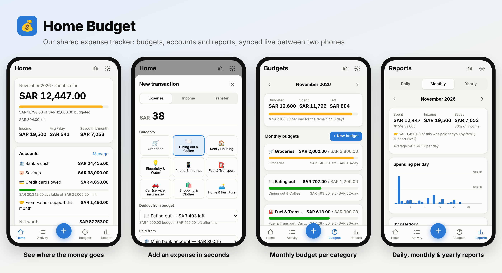

# 💰 Home Budget — our shared expense tracker

A simple, private app for two people (you and your wife) to see **where the money goes**.



- **Expenses, income and transfers**, each with a category, the account it was paid from, who paid, a date and a note.
- **Daily, monthly and yearly reports**: spending per day / month, by category, by budget, by account, by person, biggest expenses, and a comparison with the previous period.
- **Accounts**: bank, savings (with an optional goal), credit cards (limit, amount owed, available credit), cash, and **family support** (e.g. when your father pays for things on your behalf). Balances update by themselves as you add transactions. Net worth = everything you have − card debt.
- **Monthly budgets**: e.g. *Groceries 2,000*. When you add an expense you **choose which budget to deduct from** (it's picked automatically from the category, and you can change it) and **which account to deduct from**. You see what's left and how much you can spend per day for the rest of the month.
- **Shared and live**: what one of you adds shows up on the other's phone within a second. It also works offline and syncs when you're back online.
- Installs on your phone's home screen like a normal app. No ads, no third parties, and your data stays in your own free Firebase project.
- Backup/restore (JSON) and export to Excel (CSV).

---

## How the app works (60-second tour)

| Screen | What it's for |
|---|---|
| **Home** | This month's spending, budget left, income, how much you saved, account balances, top categories, recent transactions. |
| **Activity** | Every transaction, grouped by day with a daily total. Search, and filter by type, account, category, budget or person. Tap a transaction to edit or delete it. |
| **＋ (big button)** | Add an **Expense** (category → budget → paid from account), **Income** (category → received into account), or a **Transfer** (e.g. *Bank → Credit card* to pay the card, or *Bank → Savings*). |
| **Budgets** | Monthly limit per budget, with green / amber / red progress bars. Tap one to see its expenses and the last 6 months. Use ‹ › to look at past months. |
| **Reports** | Switch between **Daily / Monthly / Yearly**. Tap a category to see its transactions. |
| **🏦 (top right)** | Accounts. Tap an account to correct its balance, change the card limit or set a savings goal. |
| **⚙ (top right)** | Names, currency, categories, sync status, backup and export. |

**Good habits**
- Add expenses as they happen (it takes about 5 seconds). The **Save & add another** button helps after a big shopping trip.
- **Paying the credit card** is a **Transfer** from the bank to the card, not an expense. The card purchases were already counted when you made them, so this avoids counting them twice.
- **Moving money to savings** is also a **Transfer**.
- Once a month, compare each account with your bank app. If it's off, open the account and type in the real balance. The app adjusts.
- A new budget amount applies from the month you're viewing onwards. Past months keep their old amount.

**When family pays for you (e.g. "Father support")**
- Create it once: **🏦 → + Add account → Type: 🤝 Family support** (the name *Father support* is filled in for you).
- When your dad pays for something for you, add a normal **Expense** and choose **Paid from: Father support**. It counts in your spending, categories and budgets, so reports still show the true cost of your life, but it doesn't reduce your bank balance.
- When he sends you money, add a **Transfer** from **Father support** to your bank (the bank is picked for you).
- You'll see how much he covered this month and this year on Home, on the account, and in Reports ("🤝 X of this was paid for you by family support").
- By default it's treated as a **gift**: not your money and not a debt, so it stays out of net worth. If you plan to pay it back, open the account and tick **We will pay this back**. It then shows "We owe X" and counts as debt. Paying him back is a **Transfer** from your bank to Father support.

---

## Use it together with your wife: the easy way (no setup)

The app is published as a private page on claude.ai with its own shared database:
**https://claude.ai/artifact/RomH6sxqkeP6QSdVVrCzHu**

1. Open the link and fill in the short setup (both names, currency, account balances).
2. Click **Share** at the top of the page, invite your wife's email, and choose **Editor**.
3. She opens the link on her phone, signs in to claude.ai (a free account is enough), and picks her name when the app asks "Who are you?".

That's it. You both see and edit the same budget live. Only people you share the page with can open it.
On a phone, open the link in the Claude app or in the browser; in the browser you can also use **Add to Home Screen**.

To publish a new version after changing the code: `python3 tools/build-artifact.py` and publish `dist/home-budget.html` to the same claude.ai page.

---

## Alternative: your own Firebase + GitHub Pages (one-time setup, about 15 minutes)

Use this only if you'd rather not use claude.ai. It also works offline.

Without this step the app still works, but it saves data only on the phone/browser where you use it.
To **share one budget on both phones**, connect it to a free Google Firebase project:

### 1. Create the Firebase project (free "Spark" plan)
1. Go to <https://console.firebase.google.com> and sign in with your Google account.
2. Click **Add project**, name it e.g. `our-budget` (Google Analytics is not needed), and click **Create**.

### 2. Turn on sign-in and create both accounts
1. In the left menu: **Build → Authentication → Get started**.
2. On the **Sign-in method** tab, enable **Email/Password** and save.
3. On the **Users** tab, click **Add user** twice: once with **your** email and a password, once with **your wife's** email and a password.
   (There's no sign-up page in the app, so nobody else can create an account.)

### 3. Create the database and lock it to the two of you
1. **Build → Firestore Database → Create database**, pick a location close to you (e.g. `europe-west` or `me-central`), and start in **production mode**.
2. Open the **Rules** tab and paste the contents of [`firestore.rules`](firestore.rules) from this repo, with the two example emails **replaced by your real emails**:
   ```
   && request.auth.token.email.lower() in [
     'you@gmail.com',
     'yourwife@gmail.com'
   ];
   ```
3. Click **Publish**. From now on, only those two signed-in emails can read or write your data.

### 4. Connect the app to your project
1. Go to **Project settings** (gear icon) → **Your apps** → click the **`</>` (Web)** icon. Register the app with any nickname. You don't need Firebase Hosting.
2. Firebase shows a `firebaseConfig = { apiKey: ..., authDomain: ..., ... }` block. Copy those values into [`js/config.js`](js/config.js):
   ```js
   export const CONFIG = {
     firebase: {
       apiKey: 'AIza…',
       authDomain: 'our-budget-xxxx.firebaseapp.com',
       projectId: 'our-budget-xxxx',
       storageBucket: 'our-budget-xxxx.appspot.com',
       messagingSenderId: '…',
       appId: '1:…:web:…',
     },
     householdId: 'home',
   };
   ```
   This config isn't a password. It only says which project to talk to. Your data is protected by the login and the rules from step 3.
3. Commit and push the change.

### 5. Put the app online (free, with GitHub Pages)
1. On GitHub: **this repo → Settings → Pages**.
2. Under **Build and deployment**, choose **Deploy from a branch**, branch **`main`**, folder **`/ (root)`**, and click **Save**.
3. After a minute, your app is live at `https://<your-github-username>.github.io/expeness/`.
4. Back in Firebase: **Authentication → Settings → Authorized domains → Add domain** → `<your-github-username>.github.io`.

> GitHub Pages on a free account needs the repository to be **public**. That's OK: the code contains no secrets, and your data lives in Firebase behind your logins.
> If you'd rather keep the repo private, use **Firebase Hosting** instead (also free): install the Firebase CLI, run `firebase init hosting` in this folder (public directory `.`, single-page app: No), then `firebase deploy`.

### 6. Install it on both phones
- **iPhone (Safari):** open the link → **Share** button → **Add to Home Screen**.
- **Android (Chrome):** open the link → **⋮** menu → **Install app** / **Add to Home screen**.
- Sign in with your own email and password. Your wife does the same on her phone with hers.

### 7. First launch
- The first one of you to sign in sees a short **setup**: both names (with your login emails, so the app knows who is adding what), the currency, and your current bank / savings / credit-card balances. The default categories are created for you.
- The second person signs in and lands straight on the shared Home screen.
- Then go to **Budgets** and set your monthly limits, or tap **Create one per category** and fill in the amounts.

Already used the app before connecting Firebase? Open **⚙ Settings → Upload data saved on this device**, or use **Download backup** in the old setup and **Restore / import backup** in the new one.

---

## Tech notes

- Plain HTML, CSS and JavaScript (ES modules). No build step and no dependencies to install. Firebase SDK v10 is loaded from Google's CDN only when `js/config.js` has a config.
- Three storage modes, picked automatically: the claude.ai shared database when the page runs on claude.ai (`ArtifactBackend` in `js/store.js`), Firebase when `js/config.js` has a config, otherwise this device only.
- On claude.ai the data is stored as `app/{accounts,categories,budgets,meta}` and one `months/<YYYY-MM>` document per month, each holding `{ items: { <id>: record } }`. Saves merge one item at a time, so two people saving at once don't overwrite each other.
- Data model (Firestore: `households/<householdId>/<collection>/<id>`):
  - `accounts`: `{ name, type: bank|savings|credit|cash|support, openingBalance, limit, goal, repay }`. The current balance = opening balance + all transactions (credit cards are negative when money is owed).
  - `categories`: `{ name, icon, kind: expense|income }`
  - `budgets`: `{ name, icon, categoryIds[], amounts: { 'YYYY-MM': amount } }`. Each month uses the most recent amount set on or before it.
  - `transactions`: `{ type: expense|income|transfer, amount, date, accountId, toAccountId, categoryId, budgetId, memberId, note }`
  - `meta/settings`: `{ currency, householdName, members: [{ id, name, email }] }`
- Offline: a service worker caches the app; Firestore's offline cache keeps your data and queues changes.
- Run locally: `python3 -m http.server 8000`, then open <http://localhost:8000>.
- Test against the Firebase emulator: add `emulators: { host: '127.0.0.1' }` inside `CONFIG.firebase` and run `firebase emulators:start --only auth,firestore`.
